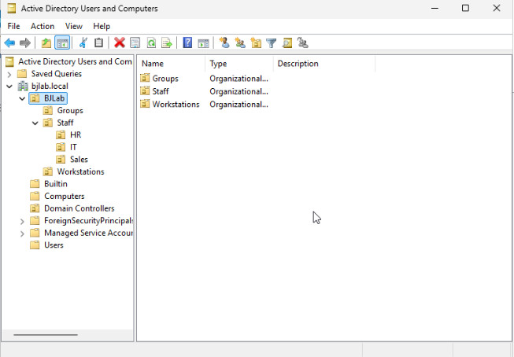
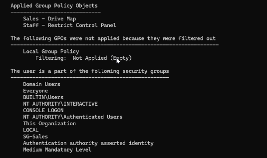
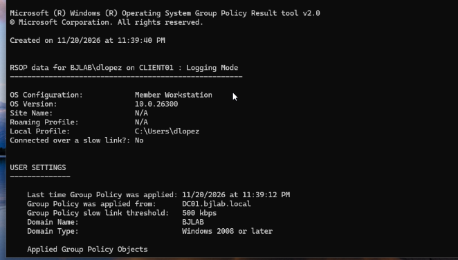
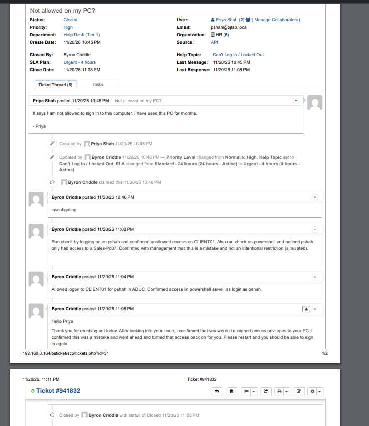

# Home Lab — bjhomeserver

Hands-on IT lab on an always-on Ubuntu server, built to practice the work of a help desk / IT support technician: Windows administration, Active Directory, ticket handling, and documentation. Security monitoring comes later as I move toward SOC work.

**Start here:** [08 — Troubleshooting a DC clock 6 hours off](docs/08-dc-time-sync.md) · [07 — Ticket generator + help desk practice](docs/07-ticket-generator.md) · [05 — Group Policy](docs/05-group-policy.md)

## Infrastructure

| Component | Details |
|-----------|---------|
| Host OS | Ubuntu Server 24.04 LTS (headless, managed over SSH) |
| Hardware | 16 GB RAM, 1 TB NVMe |
| Hypervisor | KVM/QEMU, managed through Cockpit |
| Ticketing | osTicket v1.18.4 on the host (Apache, MariaDB, PHP) |
| Other services | Game servers managed with AMP |

## Lab Machines

| Name | OS | Role | IP |
|------|----|------|----|
| DC01 | Windows Server 2025 | Domain controller, DNS, file share for `bjlab.local` | 192.168.122.10 (static) |
| CLIENT01 | Windows 11 Enterprise | Domain-joined workstation | DHCP on 192.168.122.0/24 |

The VMs run on a private NAT network (192.168.122.0/24), kept separate from my home network.

## Lab Roadmap

### Phase 1 — Hypervisor setup (complete)
- [x] Ubuntu server running 24/7
- [x] Audit and clean up unused services and scheduled jobs → [write-up](docs/01-server-audit-cleanup.md)
- [x] Install KVM + Cockpit for VM management
- [x] Download Windows Server 2025 and Windows 11 Enterprise evaluation ISOs

### Phase 2 — Fake company domain (complete)
- [x] Windows Server 2025 VM promoted to domain controller (AD DS, DNS)
- [x] Windows 11 client VM joined to the domain
- [x] OUs, users, and security groups for a small fake company
- [x] Group Policy: account lockout, mapped drive, Control Panel restriction

### Phase 3 — Help desk practice (in progress)
- [x] osTicket installed (v1.18.4 on Ubuntu, Apache + MariaDB + PHP)
- [x] First ticket worked end to end: new hire account → [write-up](docs/06-first-ticket.md)
- [x] Ticket generator + lab reset scripts (11 scenarios, two-issue tickets) → [write-up](docs/07-ticket-generator.md)
- [x] Simulated tickets worked: disabled, expired, locked, password flag, group, wrong OU
- [x] osTicket configured (departments, help topics, SLAs, organizations) → [write-up](docs/09-osticket-config-and-v2-tickets.md)
- [ ] New scenarios practiced: ✅ logon hours, ✅ workstation, ✅ share permission, ✅ GPO link, ⬜ trust relationship
- [ ] Printer and HR share scenarios

### Phase 4 — Security monitoring (later)
- [ ] Sysmon on Windows endpoints
- [ ] Wazuh SIEM collecting Windows logs
- [ ] Investigate simulated attacks and write incident reports

## Write-ups

| # | Topic | Skills |
|---|-------|--------|
| 01 | [Server audit and cleanup](docs/01-server-audit-cleanup.md) | Linux, cron, systemd, credential hygiene |
| 02 | [Building the domain controller](docs/02-domain-controller.md) | KVM, Windows Server 2025, AD DS, DNS, static IP |
| 03 | [Joining a Windows 11 client to the domain](docs/03-client-domain-join.md) | Windows 11, UEFI/TPM, DNS, domain join |
| 04 | [Users, OUs, and groups](docs/04-users-ous-groups.md) | ADUC, OUs, security groups, password resets, admin account separation |
| 05 | [Group Policy and troubleshooting a mapped drive](docs/05-group-policy.md) | GPO, SMB shares, DNS, gpresult, account lockout |
| 06 | [osTicket install and first ticket](docs/06-first-ticket.md) | osTicket, Apache, MariaDB, ticket workflow, user provisioning |
| 07 | [Ticket generator and help desk practice](docs/07-ticket-generator.md) | PowerShell scripting, REST API, Task Scheduler, AD troubleshooting |
| 08 | [Domain controller clock 6 hours off](docs/08-dc-time-sync.md) | NTP/w32tm, routing, layered troubleshooting |
| 09 | [osTicket configuration + new ticket types](docs/09-osticket-config-and-v2-tickets.md) | osTicket admin, SLAs, triage, share/NTFS permissions, GPO links |

## Skills Used So Far
`Ubuntu Linux` `SSH` `Bash` `cron` `systemd` `KVM` `Windows Server 2025` `Windows 11` `Active Directory` `Group Policy` `DNS` `PowerShell` `SMB file shares` `Apache` `MariaDB` `osTicket` `AMP game server management` `REST API` `Task Scheduler` `NTP`

## Planned
`Sysmon` `Wazuh`

## Screenshots

| Active Directory OU structure | Group Policy applied to a Sales user |
|---|---|
|  |  |  |

| A finished help desk ticket |
|---|
|  |

## Certifications
- CompTIA A+ — in progress
- CompTIA Security+ — planned
